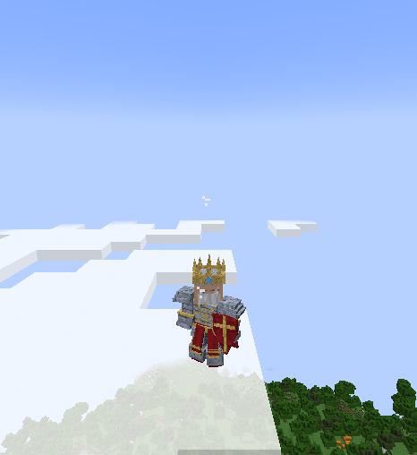
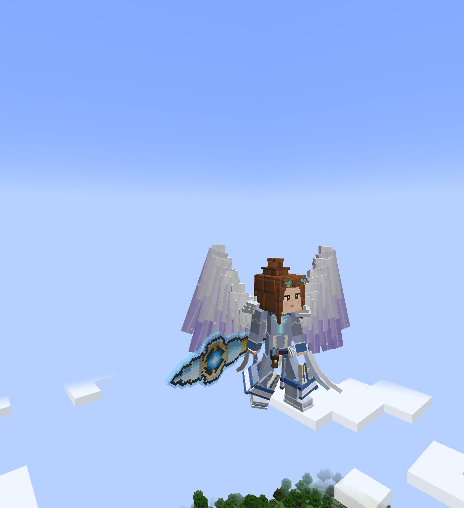
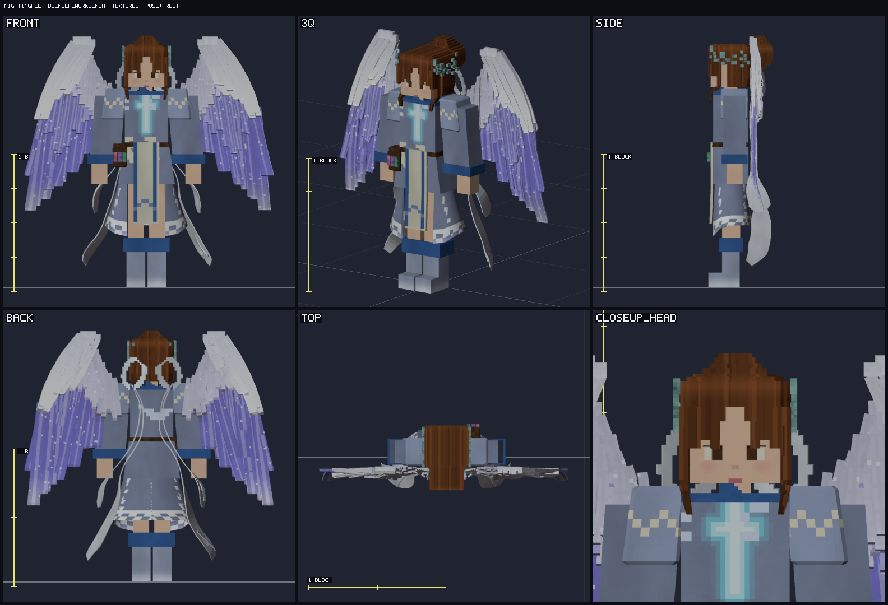
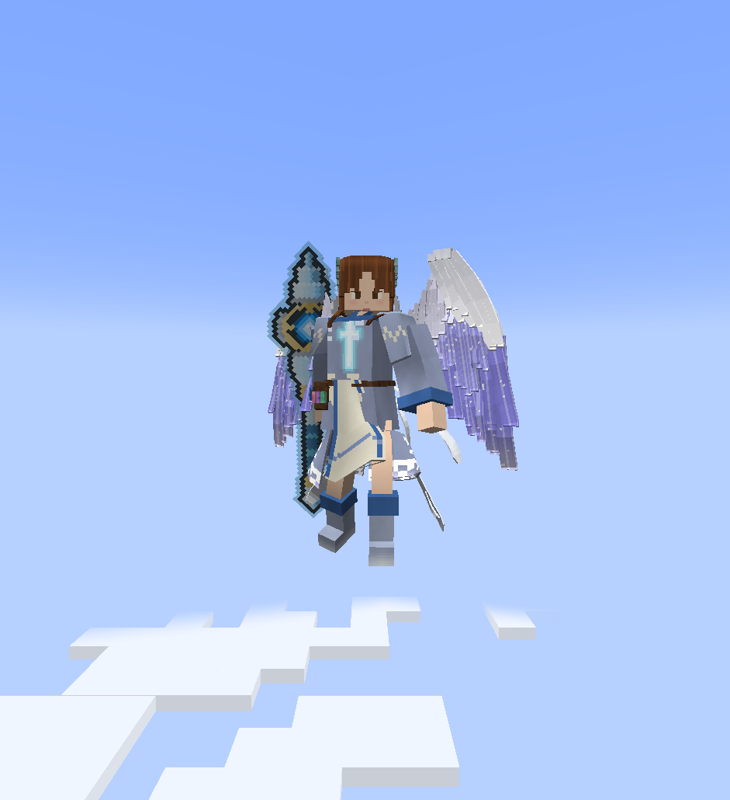

# Epic Fight Boss Forge

An agent skill that designs and generates **Epic Fight-native bosses** for **Forge 1.20.1** mods: one JSON spec in, a finished boss out.


What you get from one `boss.json`:

- **Boss spec** with size in blocks ("3 tall, 1 wide"), lore, stats, tier (major / quest / mini / hidden), phases, abilities, encounter.
- **Unique boss shapes**: a custom Epic Fight mesh per boss, skinned to the stock EF biped rig so every EF animation still works. Pick a silhouette (knight, warlord, brute, colossus, caster, beast, fiend, skeletal king, wraith, insectoid), tune proportions, add crowns, horns, wings, capes, tails, pauldrons, shields, extra arms or free-form boxes.
- **Blender-modelled bosses**: model the body and weights in Blender (headless Blender 4.2+, tested on 5.2.1; the Blender MCP is optional) on the EF biped skeleton `EF_Biped`, export an Epic Fight mesh bundle, reference it from a `mesh` block, and let the generator paint the texture. Look at the textured model in Blender from any angle, posed, and under real Epic Fight animations (walk, attacks) before it ever reaches the game (`bossforge blender view`). Round trip and animation maths are checked numerically against Epic Fight's own skinning.
- **Reference sheets**: `fit` compares the model silhouette with orthographic concept-art views (IoU, hints, overlays), `relief` builds boxes from a silhouette, `reference.bake` paints the texture from the real pixels.
- **Procedural skin**: a texture painted onto the generated mesh (8 archetypes, 15 materials, 17 features: anime face with bangs, pixel-art filigree borders and panels, glowing emblems, vertical gradients, any box targetable as `box:<id>`) plus a five-view preview (front, three-quarter, side, back, texture) and, for custom shapes, a body-and-face closeup to review before you commit.
- **Weapon generator**: item sprites with distinct blade, guard and pommel shapes, Epic Fight weapon capability, models with a held-size control, loot table, recipes, so players can obtain what the boss wields.
- **Epic Fight mobpatch** moveset with health-gated phases (validated against Epic Fight's parser rules).
- **Forge scaffolding**: a new mod from the official MDK with the Epic Fight dependency, or add the boss to an existing mod (entity, registry, renderer, sigil/summon item, loot, advancement, lang).

In game (Forge dev client, King Arthur from the example):



The same character twice, from a reference sheet. With boxes (seraph wings, bun hairdo, filigree robe, ribbons, crystal staff): `assets/examples/nightingale/boss.json`.



As a Blender-modelled mesh (smooth skinning, 9.7k triangles, 18 material groups, procedural 1024 texture): `assets/examples/nightingale-blender/` (build script, spec, exported bundle). Viewed textured in Blender (`bossforge blender view`) and in game:





Epic Fight is a hard dependency of generated mods. Humanoid bodies are built on the EF biped rig, either from boxes (`shape`) or as a Blender-modelled mesh with smooth weights (`mesh`); pieces such as wings, cloth and hair deform with the 20 EF joints but do not flap or simulate; the stock `iron_golem` mesh is also available. GeckoLib, non-humanoid skeletons and other loaders/versions are out of scope.

## Install

The repo is one skill (`skills/epicfight-boss-forge/`) packaged for several agents.

```bash
# any agent supported by vercel-labs/skills (Claude Code, Codex, Cursor, omp, ...)
npx skills add algochad/epicfight-boss-forge

# Claude Code plugin marketplace
claude plugin marketplace add algochad/epicfight-boss-forge && claude plugin install epicfight-boss-forge@boss-forge

# omp plugin marketplace
omp plugin marketplace add algochad/epicfight-boss-forge && omp plugin install epicfight-boss-forge@boss-forge
```

From a local checkout, use `npx skills add /path/to/epicfight-boss-forge` or `plugin marketplace add ./`.

## Quickstart (King Arthur)

Requirements: Python 3.9+ (standard library only), network once for the Epic Fight meshes and the Forge MDK (or `--ef-jar` / `--mdk-zip`), JDK 17 only to compile.

```bash
cd skills/epicfight-boss-forge
S=scripts/bossforge.py
python3 $S validate assets/examples/king-arthur/boss.json
python3 $S skin assets/examples/king-arthur/boss.json --out /tmp/bf-out      # then open /tmp/bf-out/bossforge/previews/king_arthur_preview.png
python3 $S new-mod --mod-id roundtable --mod-name "Round Table Bosses" --out /tmp/roundtable
python3 $S add-boss assets/examples/king-arthur/boss.json --project /tmp/roundtable
cd /tmp/roundtable && ./gradlew --no-daemon compileJava processResources
```

With an agent just say: "Make a quest boss, a 2-block-wide corrupted knight with a greatsword, in my mod at ~/mods/mymod". The skill asks only for what is missing, shows the preview for approval, then generates.

## CLI

All commands print one JSON object; exit 0 ok, 1 failure, 2 usage. Global flags `--cache-dir`, `--offline`.

| Command | Purpose |
|---|---|
| `list tiers\|archetypes\|templates\|materials\|features\|abilities\|weapon-categories\|series\|silhouettes\|presets\|animations` | valid values |
| `init` | valid starter spec |
| `validate SPEC` | check a boss or weapon spec |
| `fetch-ef-assets`, `mesh-info` | cache and inspect Epic Fight meshes |
| `skin SPEC --out DIR` | texture + preview (builds the custom mesh for `shape` bosses) |
| `shape SPEC --out DIR` | build only the custom EF mesh JSON |
| `weapon SPEC (--out DIR \| --project DIR)` | weapon files, or add a weapon to a mod |
| `patch SPEC --out DIR` | Epic Fight mobpatch JSON |
| `new-mod` | Forge 1.20.1 + Epic Fight project |
| `add-boss SPEC --project DIR` (alias `build`) | everything for a boss; idempotent, hand edits are never overwritten without `--force` |
| `lore SPEC --out DIR` | design doc |
| `qa --project DIR` | project checks |
| `render-test --project DIR` | render the boss in a Forge dev client (body, hand, outline and player screenshots), verifies the mesh EF drew and the held weapon (needs a display + JDK 17) |
| `fit SPEC --out DIR`, `reference-info IMAGE` | reference-sheet fitting: IoU per view, hints, overlay PNGs; gridded image with pixel coordinates |
| `blender doctor\|rig\|import\|export\|view` | Blender pipeline: find Blender, EF biped rig `.blend`, bundle <-> `.blend`, textured/posed/animated views (`--blender PATH`) |
| `catalog` | maintainer: rebuild the animation catalog |

## Layout

```
.claude-plugin/            plugin.json, marketplace.json
skills/epicfight-boss-forge/
  SKILL.md                 agent entry point
  agents/openai.yaml       Codex UI metadata
  references/*.md          progressive-disclosure docs
  scripts/bossforge.py     CLI; scripts/bossforge_core/ library
  assets/                  data tables, schema, Java/mod templates, King Arthur, Nightingale (boxes) and Nightingale (Blender) examples
  scripts/blender/         Blender-side code (bfk package: rig, import/export, view, modelling kit)
tests/                     python3 -m unittest discover -s tests -v
```

## Unverified in game

Everything is validated offline (specs, Epic Fight mobpatch rules, resources, texture/sprite sizes, generated Java compiled with Gradle where a JDK was available). Not verified in game: overlay-layer armor visibility, the golem renderer path, weapon hold poses, balance of the tier numbers (design defaults). See `skills/epicfight-boss-forge/references/qa.md`.

Epic Fight meshes are fetched from the Epic Fight repository into a cache (GPL); they are never copied into this repo or your mod.

## License

MIT, Copyright (c) 2026 Jhon Burn Villamor.
